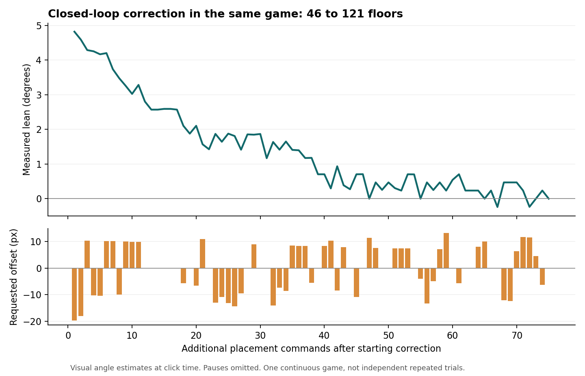

# 验证记录

日期：2026-11-06，美国东部时间。环境：Windows、Python 3.13、OpenCV 5.0.0.93、DXcam 0.3.0，主显示器中的电脑微信小程序。以下是实际测量与截图记录，不是模拟游戏成绩。

## 实机结果

同一局中，从低层自动搭建到 46 层时出现明显右倾。按照用户后续要求，在原楼上加入并测试纠偏，没有重置这局。

| 实际楼层 | 游戏显示高度 | 状态 | 视觉估计倾角 |
|---|---:|---|---:|
| 46 | 161 米 | 倾斜 | 约 4.8° |
| 57 | 200 米 | 倾斜减小 | 约 3° |
| 69 | 242 米 | 稳定 | 约 1.4°–1.8° |
| 76 | 266 米 | 稳定 | 约 1.2° |
| 121 | 424 米 | 稳定 | 约 0° |

121 层截图中，失误机会仍显示 2/2。0° 表示当前图像与直线检测分辨率下接近竖直，不是精确到无限小的角度计量。之前楼层的横向错位仍保留，纠偏改变的是整体倾斜与后续落点。



原始截图：[46 层纠偏前](reports/before_correction_46_floors.png)、[121 层恢复稳定](reports/upright_121_floors.png)。可复查数据见 `reports/correction_trace.csv`、`reports/balance_responses.json` 和 `reports/validation_summary.json`。

76→121 层这段运行中，实际处理画面约 77.8 帧/秒，处理耗时中位数 9.34 毫秒、95 分位 12.77 毫秒；输入等效延迟的最终估计约 14.5 毫秒。这些是程序与视觉轨迹测得的数值，不代表游戏物理更新率或硬件端到端延迟的独立计量。

## 回归测试

23 项测试通过，覆盖：加速度预测、重复时间戳、提前点击、错过中心、反向运动、移动目标、周期识别、过期画面、弹窗、手动释放、取消定时任务、单次触发、左右倾斜的补偿方向、补偿不污染点击偏差校准，以及真实截图中的顶层定位、缩放、立柱轴线和倾斜方向。新增出屏再入屏、倾斜横梁上的竖向分量、真实卡住轨迹、画面两侧定位、裁切楼顶、落地后摆动等待和新局底座识别检查。

Windows 桌面检查验证了 F8/Esc 消息队列接收和同一游戏窗口的单实例互斥。高层块宽缩小后，纠偏量会按预测不确定性扣除后的承托余量缩小，避免把整次放置一直阻塞在过大的纠偏要求上。继续同一局已在游戏界面确认达到 147 层、515 米，状态“稳定”，失误机会 2/2；此处为继续运行中的观察点。

执行：

```powershell
.\.venv\Scripts\python.exe -m unittest discover -s tests -v
```

源录像完整回放 1486 帧，30 FPS，720×1280。回放报告保存在 `reports/replay/`。865 帧检测到待落方块；这个数量包含悬挂和下落阶段，**不能直接作为检出率**，因为录像还有生成、落地动画和弹窗阶段。

在 46 层暂停期间记录的真实摆动轨迹上，提前约 35 毫秒预测位置：短时二次模型的绝对误差 95 分位约 11.3 像素，周期拟合约 6.3 像素。因此最终控制默认先观察至少 0.8 秒，再识别当前方块的周期与相位。

## 已知边界

### 174 层边缘卡住的复现与修复

运行 `20261106_213237_014568` 的最后一次点击之后约 110 秒没有继续放置。方块频繁移出画面，旧逻辑在丢失 0.12 秒后清空周期轨迹；起重机位于中央检测区域之外。对其中 60 秒观测每 6 帧进行一次预测，旧版有 645 次缺少有效运动拟合、12 次有拟合、0 个释放候选；保留同一方块的出屏轨迹后为 7 次缺少拟合、650 次有拟合、127 个候选。这些候选包含同一经过过程中的重复修正，不是 127 次落地。

修复后在同一局实机从 174 层推进到 180 层、630 米，解除原来的等待死锁。但随后发生过度摆动，剩余失误机会从 2/2 变为 1/2，楼顶移出右侧画面。这不是成功回正的验证。检查发现边框被误识别为轴线、裁切楼层被当作完整承托面，以及快速摆动时继续外推的风险；最终版本增加边框与裁切排除、摆动等待。新增策略通过回归测试，高层实机恢复效果仍需后续验证。

用户随后明确要求重开。旧局结算画面显示 181 层、634 米；已备份旧校准参数，进入 0 层的新局并启动最终修复版重新在线校准。新局成绩须以游戏界面及 `runs/` 后续日志为准。

- 尚未完成三局独立、从零开始的成绩重复试验；旧局与正在进行的新局不能解释为三局平均成绩或稳定胜率。
- 真实截图回归使用 9 张图片，并保留了 224 帧卡住观测；尚未建立独立的大样本人工标注集，因此不宣称整体检出率 ≥95% 或定位误差 95 分位 ≤2% 块宽。
- 原录像只有 30 FPS。离线回放验证视觉与轨迹处理，不能验证毫秒级输入或反事实游戏成绩。
- 首版针对当前游戏外观和主显示器。窗口移动、失焦、弹窗和旧画面会暂停控制。检测或支撑余量不足时等待下一次机会。
- 更高楼层继续运行时，分数与校准可能超过此处固定记录；以实际游戏画面和最新 `runs/` 日志为准。

## 298 层无操作问题

日志确认：约 22 像素高的吊绳空框被当成方块，识别目标切换到约 27–29 像素高的实际方块时，约 25 像素的高度跳变触发了错误的下落状态。修复只调整方块形状筛选，并排除被屏幕截断的方块；增加三张现场图片的回归检查。未加入屏幕采集重建等功能。

修复后在同一局连续从 298 层推进到 310 层、1085 米，游戏显示“稳定”，剩余失误机会仍为 1/2。此次以实际画面楼层增长和连续点击／落地日志验证，并非只检查程序启动状态。对应运行：`20261106_230258_116578`。
